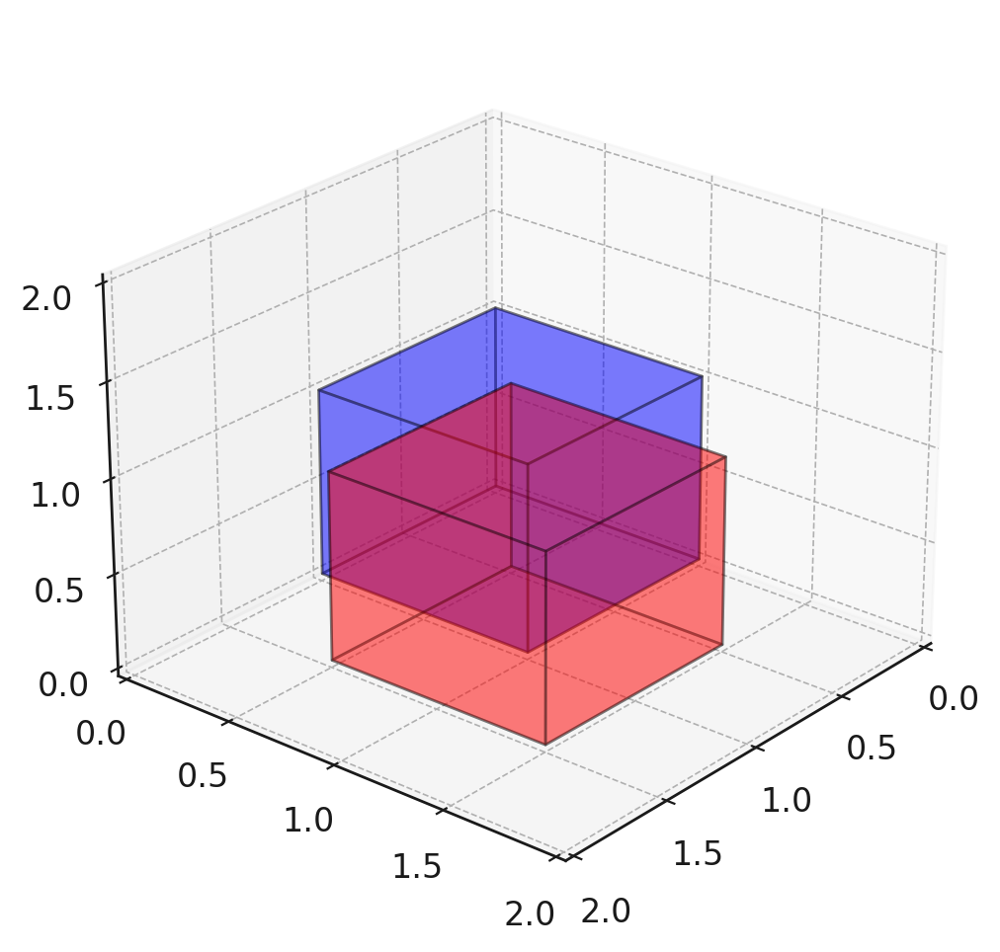

## OpenGJKSharp

[](https://www.nuget.org/packages/OpenGJKSharp)
[](https://www.nuget.org/packages/OpenGJKSharp)
[](https://github.com/HanJaeJoon/OpenGJKSharp/actions/workflows/nuget-publish.yml)
[](LICENSE)

OpenGJKSharp is a C# native implementation of the GJK (Gilbert-Johnson-Keerthi) algorithm, designed for efficient collision detection between convex polyhedra in 3D space.
This project is inspired by the original [openGJK](https://github.com/MattiaMontanari/openGJK) (written in C) and reimagined for the .NET ecosystem.

Targets `netstandard2.0`, `netstandard2.1`, `net8.0`, and `net10.0`, so it can be used from .NET Framework 4.6.2+, .NET Core 2.0+, .NET 5+, Unity 2021.2+, and Mono.

## Installation
You can install `OpenGJKSharp` via NuGet:

``` bash
dotnet add package OpenGJKSharp
```

Or using the Package Manager:

``` bash
Install-Package OpenGJKSharp
```

> **Note:** Starting with 0.3.0, the entry-point class is named `OpenGjk`
> (previously `OpenGJKSharp`, which collided with the namespace and could not be
> referenced without a namespace alias).

## Usage

Here is an example of detecting a collision between two overlapping cubes:

``` c#
using System.Numerics;
using OpenGJKSharp;

// Cube 1
var a = new Vector3[]
{
    new(0, 0, 0),
    new(1, 0, 0),
    new(0, 1, 0),
    new(1, 1, 0),
    new(0, 0, 1),
    new(1, 0, 1),
    new(0, 1, 1),
    new(1, 1, 1),
};

// Cube 2
var b = new Vector3[]
{
    new(0.5f, 0.5f, 0),
    new(1.5f, 0.5f, 0),
    new(0.5f, 1.5f, 0),
    new(1.5f, 1.5f, 0),
    new(0.5f, 0.5f, 1),
    new(1.5f, 0.5f, 1),
    new(0.5f, 1.5f, 1),
    new(1.5f, 1.5f, 1),
};

bool hasCollision = OpenGjk.HasCollision(a, b);

Console.WriteLine($"Collision detected: {hasCollision}"); // Outputs: true
```

The following image illustrates the collision between the two cubes:



### Penetration depth and contact normal (EPA)

`ComputeCollisionInformation` runs the GJK algorithm and, when a collision is detected,
the EPA (Expanding Polytope Algorithm) to compute the penetration depth and contact normal:

``` c#
double distance = OpenGjk.ComputeCollisionInformation(a, b, out Vector3 contactNormal);

if (distance < 0)
{
    // Colliding: -distance is the penetration depth, contactNormal is the contact normal
    Console.WriteLine($"Penetration depth: {-distance}, normal: {contactNormal}");
}
else
{
    // Separated: distance is the minimum distance between the two bodies
    Console.WriteLine($"Distance: {distance}");
}
```

### Minimum distance and closest points

`ComputeMinimumDistance` returns the minimum distance between two bodies
(0 when they collide) and can also report the closest point on each body:

``` c#
double distance = OpenGjk.ComputeMinimumDistance(a, b, out Vector3 closestA, out Vector3 closestB);

Console.WriteLine($"Distance: {distance}");
Console.WriteLine($"Closest points: {closestA} <-> {closestB}");
```

`HasCollision` and `ComputeMinimumDistance` also accept `Vector2[]` polygons
(treated as flat shapes on the z = 0 plane).

### Reusing buffers in a query loop (`GjkWorkspace`)

Every query needs working buffers (simplex, support points, EPA polytope). The overloads
shown above allocate them per call, which is fine occasionally but becomes steady garbage
in a physics loop. Pass a `GjkWorkspace` to reuse the buffers instead - after the first few
queries have grown them, further queries of the same kind allocate nothing:

``` c#
var workspace = new GjkWorkspace();

foreach (var (a, b) in pairs)
{
    double distance = OpenGjk.ComputeMinimumDistance(a, b, workspace);
    double info = OpenGjk.ComputeCollisionInformation(a, b, workspace, out Vector3 normal);
}
```

Every `HasCollision`, `ComputeMinimumDistance`, and `ComputeCollisionInformation` overload
has a workspace counterpart, for vertex arrays, 2D polygons, and `ISupportMappable` shapes
alike. A workspace holds no result state, so it can be reused as soon as a query returns.
It is **not thread-safe**: use one workspace per thread.

### Shapes and custom support functions

GJK is a support-function-based algorithm, so shapes like spheres and capsules can be
handled exactly - without tessellation - through the `ISupportMappable` interface.
Built-in shapes live in `OpenGJKSharp.Shapes`:

``` c#
using OpenGJKSharp;
using OpenGJKSharp.Shapes;
using System.Numerics;

var sphere = new Sphere(new Vector3(0, 0, 0), radius: 1f);
var box = new Box(new Vector3(3, 0, 0), halfExtents: new Vector3(1, 1, 1));

bool hit = OpenGjk.HasCollision(sphere, box);
double distance = OpenGjk.ComputeMinimumDistance(sphere, box, out Vector3 onSphere, out Vector3 onBox);
double info = OpenGjk.ComputeCollisionInformation(sphere, box, out Vector3 contactNormal);
```

`Sphere`, `Capsule`, `Box` (oriented, via a `Quaternion`), and `ConvexHull` are provided.

`TransformedShape` places any of them - or your own shape - at a pose, so a shape can be
defined once in local space and moved without rebuilding it. It is the only mutable shape:
`SetPose` updates the pose in place, which keeps a physics loop free of per-frame rebuilds:

``` c#
var hull = new ConvexHull(localPoints);   // built once, in local space
var body = new TransformedShape(hull);
var workspace = new GjkWorkspace();

foreach (var frame in frames)
{
    body.SetPose(frame.Rotation, frame.Position);
    double distance = OpenGjk.ComputeMinimumDistance(body, ground, workspace);
}
```

You can plug in any custom convex shape by implementing the interface:

``` c#
public sealed class Point : ISupportMappable
{
    private readonly Vector3 _position;

    public Point(Vector3 position) => _position = position;

    // Furthest point of the shape in the given direction (world space).
    public Vector3 GetSupportPoint(Vector3 direction) => _position;

    // An interior point, used as the initial guess for GJK.
    public Vector3 GetCenter() => _position;
}
```

Implementations must describe a convex shape, and `GetSupportPoint` must be exact for
the shape - GJK/EPA accuracy depends on it. Note that the public interface uses
single-precision `Vector3`, so support points are float-quantized on input (the
vertex-array API has the same input quantization); internal math runs in double
precision.

## License

OpenGJKSharp is licensed under [GPL-3.0](LICENSE), following the upstream
[openGJK](https://github.com/MattiaMontanari/openGJK) project. Note that GPL-3.0
has copyleft requirements — if you plan to use this library in closed-source or
commercial software, please review the license terms carefully.